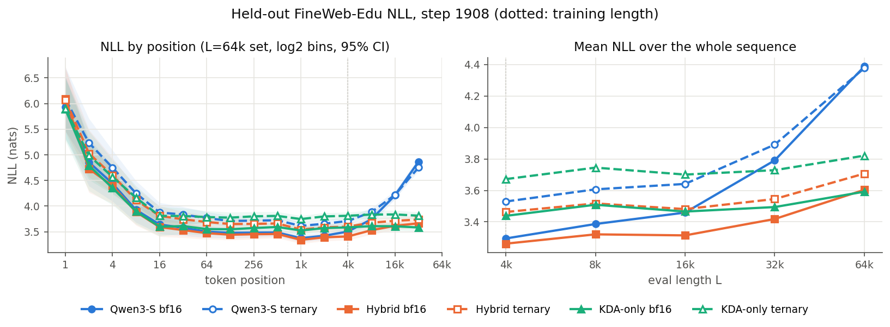
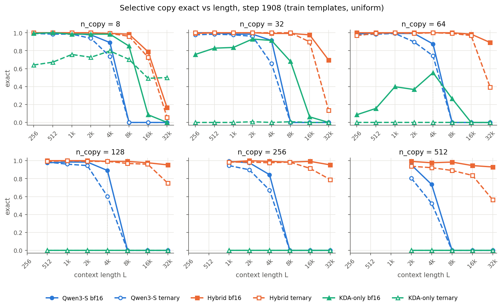
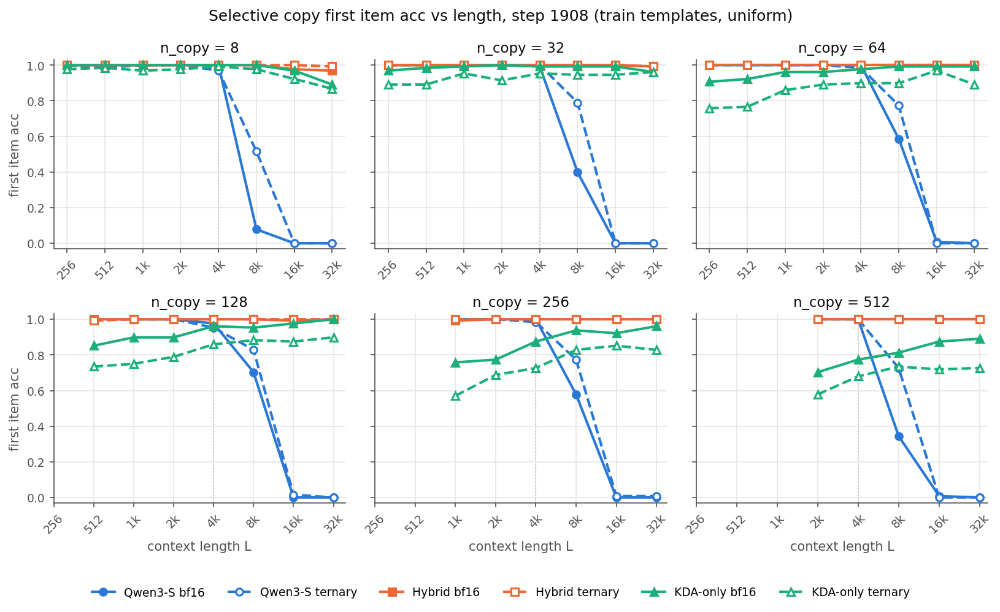
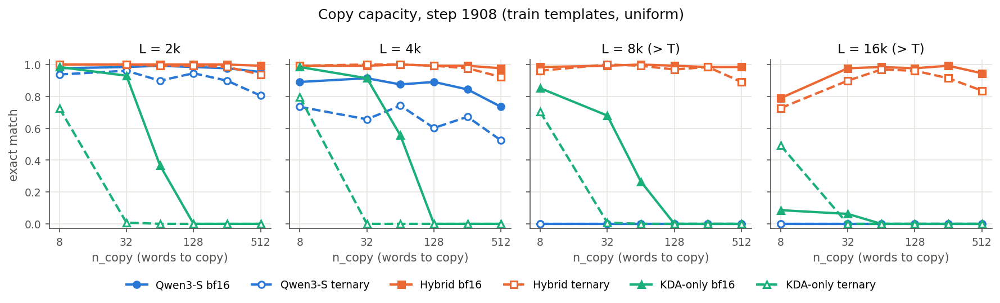
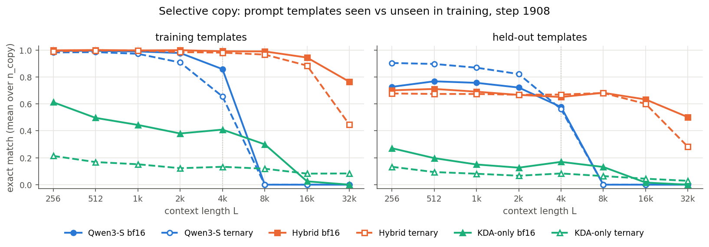
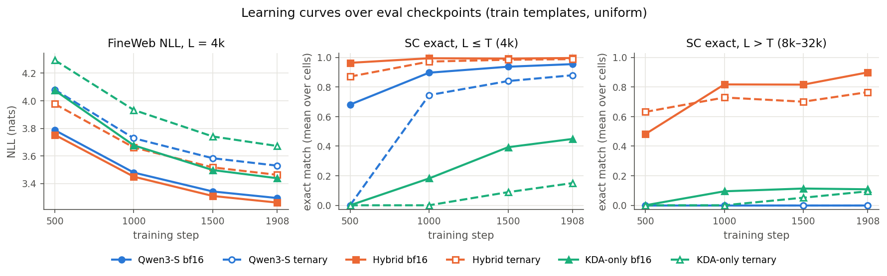
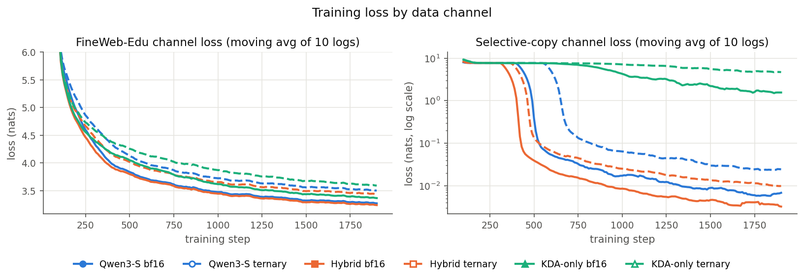
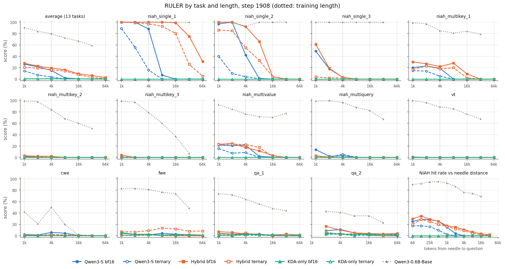
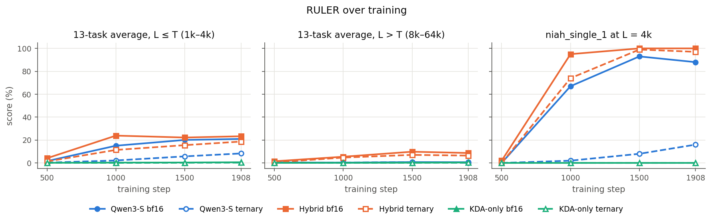

# Attention vs KDA hybrid vs KDA only, bf16 vs ternary (FineWeb-Edu + selective copy, 1B tokens)

Six runs at equal parameters, data, tokens and recipe: three architectures, each in **bf16** and with **ternary
(TWN) weights** trained by QAT.
- **Qwen3-S**: 12 full-attention layers with RoPE. This pair is the one in
  [`initial_baseline.md` → Ternary vs bf16](initial_baseline.md#ternary-vs-bf16-cap512-data-1b-tokens).
- **Qwen3-S-Hybrid**: 9 Kimi Delta Attention (KDA) layers and 3 full-attention layers without positional encoding.
- **Qwen3-S-KDA (KDA only)**: all 12 layers KDA, no attention anywhere.

The hybrid and KDA-only pairs are new. Full log: `~/diary/2026-10-19-hybrid-kda.md`.

Selective-copy (SC) numbers use **training templates, uniform placement** unless stated, as in the baseline write-up.

**Takeaways**
- **The hybrid is better in-distribution.** FineWeb NLL at L = 4k: 3.262 vs 3.295 (bf16) and 3.463 vs 3.529 (ternary),
  and the gap holds at every eval checkpoint. Within T it copies almost perfectly: SC exact ≥ 0.98 for every n_copy
  up to 512 in bf16, vs 0.73–0.91 for Qwen3-S at L = 4k.
- **The hybrid generalizes in length; Qwen3-S does not.** Past T = 4k, Qwen3-S's SC exact match is 0 at every
  length. The hybrid keeps 0.99 / 0.97 (bf16 / ternary) at 8k, 0.94 / 0.88 at 16k and 0.76 / 0.45 at 32k. Its
  FineWeb NLL stays nearly flat to 64k (3.26 → 3.60), while Qwen3-S rises to 4.39.
- **Long-range failures are about spacing, not retrieval.** The hybrid's first-item accuracy is ≥ 0.97 in every
  cell up to 32k (mean ≥ 0.99), in both precisions. What fails is the next item when consecutive words are far apart. Exact match falls with the
  gap L / n_copy: ≈ 0.95 at 256-token spacing, 0.7–0.8 at 1–2k and 0.16 at 4k (n = 8, L = 32k, bf16).
- **Ternary costs the hybrid about as much NLL as Qwen3-S** (+0.20 vs +0.23 nats at 4k), but more at long range:
  SC exact at 32k drops 0.76 → 0.45, and the n = 8 / 32 cells collapse first. Within T, ternary barely matters for
  the hybrid (exact ≥ 0.92 for n up to 512 at 4k, vs 0.52 for ternary Qwen3-S at n = 512).
- **Held-out prompt templates do not follow suit.** At L ≤ 2k, Qwen3-S ternary (0.82–0.90) beats both hybrids
  (0.67–0.71) and Qwen3-S bf16 (0.72–0.77). The hybrid is flat across lengths (0.65–0.71 up to 8k), so its gap is
  prompt transfer, not copying. One seed; not diagnosed.
- **RULER agrees, within the model's (small) capability.** Both architectures only solve single-needle retrieval,
  but the hybrid keeps it past T: niah_single_1 is 100 at 8k and 99 at 16k (Qwen3-S: 7 and 0), and the 13-task
  average past T is 8.7 vs 0.6. Ternary costs the hybrid much less retrieval than it costs Qwen3-S (13-task average
  within T: 18.7 vs 8.3). See [RULER](#ruler).
- **KDA alone is not enough: the 3 attention layers carry exact recall.** Without them (KDA only), NLL within T is
  worse than either attention model (3.438 vs 3.262 hybrid / 3.295 Qwen3-S, bf16) and RULER is ≈ 0 at every length,
  including single-needle retrieval at 1k. The copy task is barely learned: its train SC loss never collapses
  (the attention models drop below 1 nat by step 330–590) but declines slowly to ≈ 1.6 nats, and ternary KDA-only
  stays above 3.9. Its copying shows a fixed-state capacity
  limit: exact match 0.98 at n = 8 within T, at most 0.55 at n = 64, 0 from n = 128 on (bf16). What KDA alone does keep is
  length robustness: NLL rises only 0.15 from 4k to 64k, the flattest of the three. See
  [KDA only](#kda-only-no-attention-layer).
- **The hybrid is slower per token at this size,** despite 21% fewer nominal FLOPs per token: 55.3k vs 62.6k
  tokens/s per GPU (bf16) and MFU 6.8% vs 8.7%. Likely kernel overhead at this small width (448-dim KDA
  projections, 7 heads); not profiled.

## Runs

| run | dir (`~/runs/longctx/…`) | code | wandb |
|---|---|---|---|
| Qwen3-S bf16 | `qat_pair_1B/bf16` | `longctx-synth` @ `6bd6eeaf` | offline (`wandb/offline-run-20261019_000831-lf1dkn0g`) |
| Qwen3-S ternary | `qat_pair_1B/ternary` | `longctx-synth` @ `6bd6eeaf` | offline (`wandb/offline-run-20261018_231630-mvbg772y`) |
| Hybrid bf16 | `hybrid_pair_1B/bf16` | `hybrid-cache` @ `746aab53` | [longctx/d1qe9avq](https://forge.coreweave.com/wandb/shumingh/longctx/runs/d1qe9avq) |
| Hybrid ternary | `hybrid_pair_1B/ternary` | `hybrid-cache` @ `fd8aaa07` | [longctx/cpbyonao](https://forge.coreweave.com/wandb/shumingh/longctx/runs/cpbyonao) |
| KDA-only bf16 | `kda_pair_1B/bf16` | `longctx-synth` @ `1387d511` | [longctx/abcwws6n](https://forge.coreweave.com/wandb/shumingh/longctx/runs/abcwws6n) |
| KDA-only ternary | `kda_pair_1B/ternary` | `longctx-synth` @ `1387d511` | [longctx/z2l1j2ju](https://forge.coreweave.com/wandb/shumingh/longctx/runs/z2l1j2ju) |

The two hybrid commits differ only in eval/metrics code (standalone kernel default, per-GPU tokens/s, MFU), not in
the training path. All are merged into `longctx-synth` (`219b9a15`). The KDA-only commit adds its config and
generation support for a cache without attention layers; its training path is the same KDA code.

## Model: Qwen3-S-Hybrid

| | |
|---|---|
| Config | `configs/model_configs/qwen/Qwen3-S-hybrid-kda.json`, model type `qwen3_hybrid` (`veomni/models/transformers/qwen3_hybrid/`) |
| Shared with Qwen3-S | hidden 768, 12 layers, SwiGLU FFN 2048, RMSNorm 1e-6, untied embeddings, vocab 151,936, Qwen3 tokenizer, muP init |
| Layer pattern | `[KDA, KDA, KDA, attention] × 3` (`full_attention_interval` 4): layers 3, 7, 11 are full attention |
| Full-attention layers | the Qwen3 attention module (12 q / 4 kv heads, head_dim 64, q/k-norm), **no RoPE (NoPE)** |
| KDA layers | Kimi Delta Attention (Kimi Linear): 7 heads, d_k = d_v = 64. q, k, v = SiLU(depthwise causal conv, width 4); q, k L2-normalized; per-channel forget gate g = −exp(A_log)·softplus(f_proj(x) + dt_bias), with f_proj low-rank (rank 64); β = sigmoid(b_proj(x)); gated delta rule over a [64 × 64] state per head; output o_proj(RMSNorm(o) · sigmoid(g_proj(x))), with g_proj low-rank. Parameter names follow `fla.layers.KimiDeltaAttention`. |
| Parameter match | KDA mixer 1,543,623 params vs attention mixer 1,572,992 (−1.9%; 8 heads would be +11%). Model: **308.6M total / 75.25M non-embedding** vs 308.9M / 75.52M for Qwen3-S |
| KDA init | A_log = log U(1, 16), dt_bias = 0, short convs U(±1/√4); muP for every Linear |
| Kernels | flash-linear-attention **0.5.2** Triton: `chunk_kda` (training, forward + backward, varlen `cu_seqlens` so packed documents never share state), `fused_recurrent_kda` (inference inputs ≤ 64 tokens, forward only), FLA causal conv1d and gated RMSNorm. VeOmni ops `chunk_kda` / `fused_recurrent_kda` (`veomni/ops/kernels/kda/`), with an FP32 token-recurrence `eager` reference for tests. |
| Generation | HF `DynamicCache` built from `layer_types`: a KV cache on the 3 attention layers; on the KDA layers, the recurrent state plus the last 4 inputs of each q/k/v conv. Padded positions have their KDA inputs zeroed, so left padding leaves the state at exactly zero (needed by RULER's `generate`). |

**Qwen3-S-KDA (KDA only)**: the same model with all 12 layers KDA (`configs/model_configs/qwen/Qwen3-S-kda-only.json`,
`layer_types` = 12 × `linear_attention`), so it has no attention layer and no positional information beyond causal
order. Generation uses `Qwen3HybridCache`: a `DynamicCache` that counts the tokens it has seen, since HF `generate`
reads the sequence length from an attention layer and this model has none.

### Parameter budget vs Qwen3-S

| | Qwen3-S | Qwen3-S-Hybrid | Qwen3-S-KDA (KDA only) |
|---|---|---|---|
| Mixer per layer | attention: 1,572,992 | KDA: 1,543,623 (−1.9%) | KDA: 1,543,623 (−1.9%) |
| Mixers replaced | — | 9 of 12 (layers 3, 7, 11 keep the identical attention) | 12 of 12 |
| MLPs, norms | identical | identical | identical |
| Embedding + untied lm_head | 233.4M | 233.4M | 233.4M |
| **Non-embedding** | **75.52M** | **75.25M (−0.35%)** | **75.17M (−0.47%)** |
| Total | 308.89M | 308.63M (−0.09%) | 308.54M (−0.11%) |
| Ternarized (QAT arms) | 75.5M in 84 matrices | 75.18M in 129 matrices | 75.07M in 144 matrices |
| FLOPs per token (fwd + bwd, 4k docs) | 1.61 G | 1.27 G (−21%) | 1.16 G (−28%) |

Attention mixer: q (768→768), k and v (768→256 each, 4 KV heads), o (768→768), q/k-norm. KDA mixer at head_dim 64
(as attention): q/k/v/o at 7 × 64 = 448 dims, low-rank (64) forget and output gates, β projection, three width-4
short convs, A_log, dt_bias. 7 heads is the closest match (−1.9%); 8 heads would be +11%. Checked by
`tests/models/test_qwen3_hybrid.py::test_qwen3_s_hybrid_matches_qwen3_s_shape_and_params`. Parameters are matched
(the more, smaller ternarized matrices come from the low-rank gates and β); compute is not (quadratic attention on 12,
3 or 0 layers).

**Ternary (TWN QAT)** is the same recipe as the Qwen3-S ternary run (`veomni/ops/qat/ternary.py`). It applies to
every hidden `nn.Linear`, here **129 matrices, 75.18M parameters**: q/k/v/o, b_proj and the low-rank f/g gate
projections of each KDA layer, plus the attention and MLP projections. Embeddings, lm_head, norms, convs, A_log and
dt_bias stay bf16.

**FLA version.** `uv.lock` pins fla 0.4.1, whose `chunk_kda` backward crashes with an illegal memory access during
autotune (H200, Triton 3.6). The hybrid runs use 0.5.2 from an overlay, with the Triton backend forced (0.5.2's
default TileLang backend does not compile on this host):
`PYTHONPATH=<worktree>:~/envs/fla-0.5.2 FLA_TILELANG=0`. The KDA adapter refuses fla < 0.5.

## Training setup

Identical to the Qwen3-S pair (see [`initial_baseline.md` → Training setup](initial_baseline.md#training-setup) and
the cap512 data of the ternary section) except for the model. Summary:

| | |
|---|---|
| Config | `configs/text/longctx/qwen3_s_hybrid_T4096.yaml` (= `qwen3_s_T4096.yaml` + hybrid model, `kda_implementation: fla`, `no_decay_params: [A_log, dt_bias]`); KDA only: `qwen3_s_kda_T4096.yaml` (same, KDA-only model) |
| Data | `mix_fineweb_sc10.yaml`: FineWeb-Edu 90% + selective copy 10% of tokens (`train_T4096_cap512`: n_copy log-uniform 1..512, composed `nl2` templates), T = 4096, documents chunked at T |
| Budget | 1,908 steps × 128 × 4096 = 1.0B tokens; 8× H200, FSDP2, bf16, full activation checkpointing, seed 42 |
| Optimizer | Muon (lr 0.02, spectral √(d_out/d_in), 5-step quintic NS, wd 0) on hidden matrices; AdamW (lr 3e-3, wd 0.1) on embeddings / lm_head / norms / convs / A_log / dt_bias (the last two without decay); 1% warmup, cosine to 0.1× |
| Precision arms | `--model.qat.weight none` (bf16) or `ternary_twn` |
| Logging | wandb online (project `longctx`). Per-layer `grad_norm/layer_XX`, `act_rms/layer_XX`, `act_absmax/layer_XX` every 10 steps (`train.layer_stats`); `tokens_per_second_per_gpu`; `mfu` (hybrid FLOP model added in `b12d5ebd`) |
| Runs | Hybrid: `~/runs/longctx/hybrid_pair_1B/run.sh` (ternary, 02:38–03:27) and `run2.sh` (bf16 05:58–06:41, then all merges and evals). bf16 ran with `FLA_CACHE_RESULTS=0` (fresh in-process autotune); ternary used the default on-disk autotune cache. KDA only: `~/runs/longctx/kda_pair_1B/run.sh` (2026-10-20, ternary 19:09–20:33, bf16 20:33–21:46, `FLA_CACHE_RESULTS=0`), with a foreign job sharing all 8 GPUs for most of training (losses unaffected; throughput not usable, see below) |

### Throughput (median over steps > 50; 8× H200, 0.5M tokens / step)

| run | s / step (wall, incl. ckpt) | tokens/s per GPU | MFU |
|---|---|---|---|
| Qwen3-S bf16 | 1.26 | 62,583 | 0.087 |
| Qwen3-S ternary | 1.26 | 59,198 | 0.082 |
| Hybrid bf16 | 1.36 | 55,284 | 0.068 |
| Hybrid ternary | 1.53 | 47,428 | ≈ 0.058 (not logged; scaled from bf16 by tokens/s) |
| KDA-only bf16 / ternary | 2.28 / 2.62 (contended) | not measured cleanly (GPUs shared with a foreign job) | – |

Nominal FLOPs per token (fwd + bwd, 4k documents): Qwen3-S 1.61 G, hybrid 1.27 G (quadratic attention term on 3
layers instead of 12; KDA recurrence counted as 15·d_k·d_v·H per token, as for GatedDeltaNet). MFU uses each model's
own FLOP count, so lower MFU at equal tokens/s means fewer FLOPs, not idle hardware. The hybrid ternary run's lower
throughput may partly be the stale autotune cache (bf16 → `FLA_CACHE_RESULTS=0`, not a controlled comparison).

**KDA-only throughput: inconclusive.** A back-to-back benchmark of the three bf16 models (60 steps each, same 4
GPUs, `~/runs/longctx/throughput_bench/run.sh`, median of steps 21–60) gave 67.7k (Qwen3-S), 28.9k (hybrid) and
28.6k (KDA only) tokens/s per GPU (MFU 0.094 / 0.035 / 0.033). The hybrid ran at half its clean 8-GPU rate
(51–55k from step 5 on), and only the FLA-kernel models slowed. Foreign processes held memory on those GPUs
throughout, which is the likely cause; we could not verify it. So the only result we take from it is that KDA-only
and the hybrid run at the same speed under identical conditions. Nominal FLOPs per token are 1.16 G for KDA only
vs 1.27 G for the hybrid. A clean 8-GPU rerun is needed for absolute numbers.

## Evaluation setup

Same as the Qwen3-S ternary section of `initial_baseline.md`. `scripts/longctx/eval_longctx.py` runs one
teacher-forced forward per sequence in bf16, with sdpa for the attention layers and FLA kernels for KDA. Ternary
checkpoints are ternarized at load (`--qat_weight ternary_twn`). Checkpoints are evaluated at steps 500, 1000, 1500
and 1908.

- **Selective copy** `~/datasets/synthetic/selective_copy/test_cap`: L ∈ {256 … 32k} × n_copy ∈ {8, 32, 64, 128,
  256, 512} × placement {uniform, early} × template split {train, test (held-out)}, with 128 fresh instances per
  cell; cells with L < 4n are skipped.
  - Metrics: **exact** (all n words in order), **first-item acc** (pure retrieval of word 1) and **token acc** (per
    word, teacher forced).
- **Positional NLL**: held-out FineWeb-Edu documents truncated to L ∈ {4k, 8k, 16k, 32k, 64k} (256 docs each; 128
  at 64k), mean NLL per position bin and over the whole sequence.

## Results

### FineWeb-Edu held-out NLL

| eval length L | Qwen3-S bf16 | Qwen3-S ternary | Hybrid bf16 | Hybrid ternary | KDA-only bf16 | KDA-only ternary |
|---|---|---|---|---|---|---|
| 4k (= T) | 3.295 | 3.529 | **3.262** | 3.463 | 3.438 | 3.672 |
| 8k | 3.386 | 3.607 | **3.321** | 3.517 | 3.509 | 3.745 |
| 16k | 3.459 | 3.641 | **3.314** | 3.481 | 3.466 | 3.701 |
| 32k | 3.791 | 3.891 | **3.418** | 3.545 | 3.494 | 3.729 |
| 64k | 4.388 | 4.377 | 3.604 | 3.707 | **3.592** | 3.821 |

Mean over the whole sequence, step 1908. Over training (L = 4k):

| step | Qwen3-S bf16 | Qwen3-S ternary | Hybrid bf16 | Hybrid ternary | KDA-only bf16 | KDA-only ternary |
|---|---|---|---|---|---|---|
| 500 | 3.787 | 4.081 | 3.753 | 3.977 | 4.076 | 4.294 |
| 1000 | 3.479 | 3.728 | 3.449 | 3.661 | 3.677 | 3.933 |
| 1500 | 3.342 | 3.583 | 3.310 | 3.517 | 3.497 | 3.741 |
| 1908 | 3.295 | 3.529 | 3.262 | 3.463 | 3.438 | 3.672 |



Per position (left), Qwen3-S's NLL turns up right after T and reaches ≈ 4.8 in the last bin (positions 32k–64k).
The hybrid's rises by only ≈ 0.25 over the same range. KDA only is the flattest of all (mean NLL +0.15 from 4k to
64k, vs +0.34 for the hybrid and +1.09 for Qwen3-S, bf16) but starts 0.18 nats behind the hybrid within T; it only
matches the hybrid at 64k. Within T, KDA-only bf16 (3.438) sits between Qwen3-S bf16 (3.295) and ternary (3.529).

### Selective copy vs length

Exact match, mean over n_copy, step 1908:

| | 256 | 512 | 1k | 2k | 4k | 8k | 16k | 32k |
|---|---|---|---|---|---|---|---|---|
| Qwen3-S bf16 | 0.99 | 0.99 | 0.99 | 0.98 | 0.86 | 0.00 | 0.00 | 0.00 |
| Qwen3-S ternary | 0.98 | 0.98 | 0.97 | 0.91 | 0.65 | 0.00 | 0.00 | 0.00 |
| Hybrid bf16 | 1.00 | 1.00 | 1.00 | 1.00 | 0.99 | **0.99** | **0.94** | **0.76** |
| Hybrid ternary | 0.99 | 1.00 | 1.00 | 0.98 | 0.98 | **0.97** | **0.88** | **0.45** |
| KDA-only bf16 | 0.61 | 0.50 | 0.44 | 0.38 | 0.41 | 0.30 | 0.02 | 0.00 |
| KDA-only ternary | 0.21 | 0.17 | 0.15 | 0.12 | 0.13 | 0.12 | 0.08 | 0.08 |

(KDA-only averages are low because cells with n ≥ 128 are 0; per-cell numbers are in [KDA only](#kda-only-no-attention-layer).)



Hybrid, exact match per cell (bf16 / ternary):

| n_copy | 256 | 512 | 1k | 2k | 4k | 8k | 16k | 32k |
|---|---|---|---|---|---|---|---|---|
| 8 | 1.00 / 1.00 | 1.00 / 1.00 | 1.00 / 1.00 | 1.00 / 1.00 | 0.99 / 0.99 | 0.98 / 0.96 | 0.79 / 0.73 | 0.16 / 0.05 |
| 32 | 0.99 / 1.00 | 1.00 / 1.00 | 1.00 / 1.00 | 1.00 / 1.00 | 0.99 / 1.00 | 0.99 / 1.00 | 0.98 / 0.90 | 0.70 / 0.13 |
| 64 | 1.00 / 0.97 | 1.00 / 0.99 | 1.00 / 1.00 | 1.00 / 0.99 | 1.00 / 1.00 | 1.00 / 0.99 | 0.98 / 0.97 | 0.89 / 0.39 |
| 128 | – | 1.00 / 0.99 | 1.00 / 1.00 | 1.00 / 0.99 | 0.99 / 0.99 | 0.99 / 0.97 | 0.98 / 0.96 | 0.95 / 0.75 |
| 256 | – | – | 0.98 / 0.98 | 1.00 / 0.98 | 0.99 / 0.98 | 0.98 / 0.98 | 0.99 / 0.91 | 0.95 / 0.79 |
| 512 | – | – | – | 0.99 / 0.94 | 0.98 / 0.92 | 0.98 / 0.89 | 0.95 / 0.84 | 0.93 / 0.56 |

Qwen3-S, same cells within T (bf16 / ternary; 0.00 / 0.00 for every cell at L ≥ 8k):

| n_copy | 256 | 512 | 1k | 2k | 4k |
|---|---|---|---|---|---|
| 8 | 1.00 / 0.99 | 1.00 / 0.98 | 0.99 / 0.98 | 0.98 / 0.94 | 0.89 / 0.73 |
| 32 | 1.00 / 0.98 | 1.00 / 0.98 | 0.98 / 0.98 | 0.98 / 0.96 | 0.91 / 0.66 |
| 64 | 0.98 / 0.98 | 1.00 / 0.98 | 0.99 / 0.99 | 0.99 / 0.90 | 0.88 / 0.74 |
| 128 | – | 0.98 / 0.98 | 0.98 / 0.96 | 0.98 / 0.95 | 0.89 / 0.60 |
| 256 | – | – | 0.99 / 0.95 | 0.98 / 0.90 | 0.84 / 0.67 |
| 512 | – | – | – | 0.95 / 0.80 | 0.73 / 0.52 |

**Where the hybrid fails at long L.** First-item accuracy (pure retrieval) stays ≥ 0.97 in every cell for both
hybrids up to 32k (mean over n ≥ 0.99).
Qwen3-S's is 0.45 / 0.73 (bf16 / ternary) at 8k and ≈ 0 from 16k. The hybrid's errors are in later items, and
they track the spacing between consecutive copied words, L / n_copy. At 32k, bf16 token accuracy is 0.84 at n = 8
(4k tokens apart) and 0.99 at n = 32 (1k apart). Exact match is 0.93–0.95 at n ≥ 128 (≤ 256 tokens apart). At the same
spacing the ternary model drops further, so ternary hurts holding item order across long gaps, not finding items.



### Copy capacity



At L = 4k the hybrids keep exact ≥ 0.92 up to n = 512, while Qwen3-S ternary falls to 0.52. At 8k and 16k only the
hybrids copy at all, apart from KDA-only bf16 at small n (0.85 at n = 8, L = 8k). KDA only has the opposite failure
to Qwen3-S: it does not break with length but with the number of items. See below.

### Seen vs held-out prompt templates

| exact, mean over n_copy | 256 | 512 | 1k | 2k | 4k | 8k | 16k | 32k |
|---|---|---|---|---|---|---|---|---|
| Qwen3-S bf16 | 0.73 | 0.77 | 0.76 | 0.72 | 0.58 | 0.00 | 0.00 | 0.00 |
| Qwen3-S ternary | **0.90** | **0.90** | **0.87** | **0.82** | 0.56 | 0.00 | 0.00 | 0.00 |
| Hybrid bf16 | 0.70 | 0.71 | 0.69 | 0.67 | 0.65 | 0.68 | 0.63 | 0.50 |
| Hybrid ternary | 0.68 | 0.67 | 0.67 | 0.67 | 0.67 | 0.68 | 0.60 | 0.28 |
| KDA-only bf16 | 0.27 | 0.20 | 0.15 | 0.13 | 0.17 | 0.13 | 0.02 | 0.00 |
| KDA-only ternary | 0.13 | 0.09 | 0.08 | 0.07 | 0.08 | 0.06 | 0.04 | 0.03 |



On held-out templates every model loses 0.2–0.3 exact match within T. The hybrid's held-out curve is flat in L, so
the loss is prompt transfer, not copying. Qwen3-S ternary is the outlier: it transfers best at short L (the same
effect as in the baseline write-up), not yet diagnosed.

### Over training and training loss





The hybrid learns the copy task earlier. Its train SC loss first drops below 1 nat at step 330 (bf16) and 390
(ternary), vs 420 and 590 for Qwen3-S; the curves above are smoothed, so they lag. Past T, hybrid bf16 is already at
0.82 exact by step 1000 (ternary 0.73). Final SC channel loss (mean of the last 10 logs) is 0.0032 / 0.0099
(bf16 / ternary) vs 0.0068 / 0.0244 for Qwen3-S. Final FineWeb channel loss is 3.241 / 3.437 vs 3.273 / 3.503: the
bf16 runs are close, and the ternary gap is smaller for the hybrid.

KDA only learns the copy task late or not at all. KDA-only bf16's SC loss never shows the sharp collapse the
attention models have; it declines slowly from step ~750 to ≈ 1.6 nats at the end (single logs dip to 0.94). KDA-only ternary never gets below 3.9 nats (chance over the 2,048-word
lexicon is 7.6). Its final FineWeb channel loss is 3.368 / 3.593 (bf16 / ternary), 0.13 / 0.16 above the hybrid.

### KDA only (no attention layer)

Exact match per cell, step 1908 (bf16 / ternary):

| n_copy | 256 | 512 | 1k | 2k | 4k | 8k | 16k | 32k |
|---|---|---|---|---|---|---|---|---|
| 8 | 0.99 / 0.64 | 1.00 / 0.67 | 0.98 / 0.76 | 0.98 / 0.73 | 0.98 / 0.80 | 0.85 / 0.70 | 0.09 / 0.49 | 0.00 / 0.50 |
| 32 | 0.76 / 0.00 | 0.83 / 0.00 | 0.84 / 0.00 | 0.93 / 0.01 | 0.91 / 0.00 | 0.68 / 0.01 | 0.06 / 0.00 | 0.00 / 0.00 |
| 64 | 0.09 / 0.00 | 0.16 / 0.00 | 0.40 / 0.00 | 0.37 / 0.00 | 0.55 / 0.00 | 0.27 / 0.00 | 0.00 / 0.00 | 0.00 / 0.00 |
| 128 – 512 | 0 in every cell | | | | | | | |

Token accuracy at L = 4k (bf16 / ternary): 1.00 / 0.97 (n = 8), 1.00 / 0.86 (32), 0.99 / 0.64 (64),
0.94 / 0.32 (128), 0.69 / 0.12 (256), 0.29 / 0.04 (512). First-item accuracy is 0.70–1.00 in every cell for bf16 and
0.57–0.99 for ternary (lowest at large n and short L).

- **A capacity limit, not a length limit.** The first word is found almost always, but how many words in order can
  be read back is bounded. Per-word accuracy falls with n at every length, as it would if the 7 KDA heads' [64 × 64]
  states held a limited number of word associations. Attention layers, which keep every token, have no such bound
  within T: the hybrid is ≥ 0.98 at n = 512.
- **Ternary shrinks that capacity.** Ternary KDA-only copies n = 8 at 0.64–0.80 and nothing beyond n = 8 (token
  accuracy 0.32 at n = 128 vs 0.94 for bf16). Oddly, its n = 8 exact match holds at 16k–32k (0.49–0.50) where bf16
  falls to 0.00–0.09. One seed; not investigated.
- **Exact match rises with L at fixed n within T** (n = 64: 0.09 at L = 256 → 0.55 at 4k; n = 32: 0.76 → 0.91). At short L the words are packed
  densely and each word's association competes with its neighbours'; with more filler between items they are
  stored more separably. Our reading; not tested.

## RULER

The standard keyed-retrieval benchmark (13 tasks, `veomni.eval.ruler`) on the same prompts the Qwen3-S checkpoints
were scored on (`~/datasets/ruler/qwen3`: 100 prompts per (task, length), L ∈ {1k … 64k}, `base` template, greedy
decoding, upstream scoring). Setup and task descriptions are in
[`initial_baseline.md` → RULER](initial_baseline.md#ruler); the Qwen3-S rows are those runs. The hybrid checkpoints
ran through the same `eval_ruler.py` command, with HF `generate`, sdpa for the attention layers, and FLA kernels
plus the generation cache for KDA (`~/runs/longctx/ruler/run_ruler_hybrid.sh`, about 10 min per checkpoint on 8×
H200, like Qwen3-S). The KDA-only checkpoints ran the same command from `~/runs/longctx/kda_pair_1B/run.sh`, on 4
GPUs (a foreign job held the other 4; RULER is data-parallel over independent prompts, so results do not depend on
the GPU count). Since the Qwen3-S runs, the eval code only gained an explicit `use_cache=True`, the `qwen3_hybrid`
model-type registration and the attention-free generation cache; prompts and scoring are unchanged.

#### 13-task average (%), step 1908

| model | 1k | 2k | 4k | 8k | 16k | 32k | 64k |
|---|---|---|---|---|---|---|---|
| Qwen3-S bf16 | 26.2 | 21.5 | 15.2 | 2.1 | 0.3 | 0.1 | 0.0 |
| Qwen3-S ternary | 14.1 | 7.2 | 3.6 | 0.3 | 0.2 | 0.0 | 0.0 |
| Hybrid bf16 | **27.7** | **22.8** | **19.3** | **16.4** | **9.3** | **6.2** | **2.8** |
| Hybrid ternary | 20.4 | 19.2 | 16.4 | 14.1 | 7.8 | 2.7 | 1.1 |
| KDA-only bf16 | 0.5 | 0.6 | 0.7 | 0.4 | 0.5 | 0.3 | 0.4 |
| KDA-only ternary | 0.1 | 0.3 | 0.4 | 0.2 | 0.3 | 0.3 | 0.3 |
| Qwen3-0.6B-Base (reference, trained to 32k) | 90.4 | 83.9 | 79.9 | 72.4 | 66.8 | 58.9 | – |

#### Tasks that score above the floor (%, L = 1k / 2k / 4k / 8k / 16k / 32k / 64k), step 1908

| task | Qwen3-S bf16 | Qwen3-S ternary | Hybrid bf16 | Hybrid ternary |
|---|---|---|---|---|
| niah_single_1 (filler haystack) | 100/100/88/7/0/0/0 | 89/56/16/0/0/0/0 | 100/100/100/100/99/75/31 | 100/99/97/93/80/26/5 |
| niah_single_2 (essay haystack) | 97/100/42/1/0/0/0 | 40/10/4/1/0/0/0 | 100/100/92/66/4/0/0 | 86/85/55/33/4/0/0 |
| niah_single_3 (uuid values) | 49/18/3/0/0/0/0 | 0/0/0/0/0/0/0 | 61/19/3/0/0/0/0 | 4/2/2/0/0/0/0 |
| niah_multikey_1 | 20/23/19/0/0/0/0 | 15/14/5/0/0/0/0 | 30/27/22/28/9/0/0 | 17/23/18/20/2/0/0 |
| niah_multivalue | 22/21/22/2/0/0/0 | 16/8/8/0/0/0/0 | 23/24/17/12/4/0/0 | 23/23/22/18/1/0/0 |
| fwe | 4/3/1/4/3/2/0 | 1/0/2/0/0/0/0 | 1/1/2/1/0/0/0 | 7/7/9/13/12/8/8 |

The other 7 tasks (multikey_2/3, multiquery, VT, CWE, QA ×2) are ≤ 16% for every model at every length. KDA only
scores **0 on all 8 NIAH tasks at every length** in both precisions; its only non-zero scores are ≤ 5% on FWE and
QA (full per-task table for all six runs: `~/runs/longctx/ruler/three_arch_tables.md`).

#### Over training (13-task average %; niah_single_1 %)

| model | step | avg, L ≤ 4k | avg, L > 4k | niah_single_1 @ 4k | @ 16k |
|---|---|---|---|---|---|
| Qwen3-S bf16 | 1000 / 1500 / 1908 | 15.1 / 20.1 / 21.0 | 0.3 / 0.7 / 0.6 | 67 / 93 / 88 | 0 / 0 / 0 |
| Qwen3-S ternary | 1000 / 1500 / 1908 | 2.2 / 5.8 / 8.3 | 0.4 / 0.8 / 0.1 | 2 / 8 / 16 | 0 / 0 / 0 |
| Hybrid bf16 | 1000 / 1500 / 1908 | 23.9 / 22.2 / 23.3 | 5.4 / 9.8 / 8.7 | 95 / 100 / 100 | 74 / 99 / 99 |
| Hybrid ternary | 1000 / 1500 / 1908 | 11.4 / 15.5 / 18.7 | 4.7 / 7.0 / 6.4 | 74 / 99 / 97 | 57 / 91 / 80 |
| KDA-only bf16 | 1000 / 1500 / 1908 | 0.3 / 0.4 / 0.6 | 0.1 / 0.2 / 0.4 | 0 / 0 / 0 | 0 / 0 / 0 |
| KDA-only ternary | 1000 / 1500 / 1908 | 0.1 / 0.2 / 0.3 | 0.1 / 0.2 / 0.3 | 0 / 0 / 0 | 0 / 0 / 0 |

At step 500 every model's 13-task average is ≤ 5.0 at every length.





**Findings**
- **Same capability ceiling, longer reach.** Like Qwen3-S, the hybrid only does single-needle retrieval: every
  task with distractors, multiple keys or multiple steps stays near the floor at every length. It is a capacity
  limit at 75M non-embedding parameters and 1B tokens, not a context effect; the 0.6B reference scores well above
  the floor on all of them.
  What changes is length. niah_single_1 stays at 99–100 up to 16k (bf16), against 7 at 8k for Qwen3-S, and
  the 13-task average past T is 8.7 vs 0.6.
- **Within T it is close.** The 13-task average at L ≤ 4k is 23.3 vs 21.0 (bf16), almost all from the NIAH
  single / multikey_1 tasks. Both models remain recency-biased within T: pooled over the NIAH tasks at L = 4k,
  needles 2–4k tokens before the question are found 16% (hybrid) and 8% (Qwen3-S) of the time, vs 44% and 39% for
  needles ≤ 64 tokens back.
- **The hybrid degrades gradually past T.** Hybrid bf16 single_1 goes 100 → 99 → 75 → 31 over 8k → 64k, and
  single_2 (essay haystack, harder) falls from 92 at 4k to 66 at 8k and 4 at 16k. Qwen3-S is at or near the floor
  on every task from 8k = 2T on (≤ 7%), the absolute-position failure (RoPE positions never trained) described in
  the baseline.
- **Ternary hurts the hybrid far less on retrieval.** Hybrid ternary keeps single_1 ≥ 93 up to 8k, where ternary
  Qwen3-S has 89 / 56 / 16 at 1k / 2k / 4k. Its 13-task average within T is 18.7 vs 8.3. Ternary still costs the
  hybrid most at long range (single_1 at 32k: 26 vs 75) and on uuid values (single_3: 4 vs 61 at 1k). This mirrors
  selective copy, where ternary mostly costs long-gap item order.
- **Retrieval appears by step 1000 for the hybrid** (bf16 single_1 at 16k: 74 at step 1000, 99 at 1500), and is
  stable or slightly down from 1500 to 1908 (32k: 75 at 1908).
- **KDA only cannot do keyed retrieval at all.** It scores 0 on niah_single_1 even at 1k, at every checkpoint.
  Its answers are not near misses. On niah_single_1 at 1k it starts with the wrong digit straight from the prompt
  (prefill, before any cache is used) and then degenerates ("10000000…"), where the hybrid copies the 7-digit value
  exactly. Its selective-copy first-item accuracy is ≥ 0.70, so it can retrieve within the trained format; finding
  a value by its key in prose is what needs the attention layers, even 3 of them.
- Oddity: hybrid ternary is the only model above the floor on FWE (frequent-words extraction, 7–13% at every
  length). One seed; not investigated.

## Caveats
- One seed per arm and a single 1B-token budget at 75M non-embedding parameters.
- The Qwen3-S pair ran at commit `6bd6eeaf` (offline wandb, no per-layer stats); the hybrid pair at `fd8aaa07` /
  `746aab53`. The training recipe is identical; only the logging differs.
- The KDA-only pair ran at `1387d511`. A foreign job (another container) shared all 8 GPUs during most of its training
  and occupied 4 of them during its evals, so its evals and RULER ran on 4 GPUs. Results are unaffected: contention changes
  speed, not the computation (beyond which kernel configs autotuning picks), and evals are data-parallel over
  independent sequences; its logged throughput is not
  usable, hence the separate benchmark.
- Throughput: the hybrid ternary run used FLA's on-disk autotune cache (possibly tuned while GPUs were shared); the
  hybrid bf16 run used `FLA_CACHE_RESULTS=0`. The Qwen3-S runs used no FLA kernels.
- Selective copy and NLL are teacher-forced (SC exact match: every answer token is the argmax given the correct
  prefix); RULER is generation-based (greedy, with the generation cache).

## Reproduce

```bash
cd ~/VeOmni-longctx    # longctx-synth >= 1387d511
export PYTHONPATH=$PWD:~/envs/fla-0.5.2 FLA_TILELANG=0 FLA_CACHE_RESULTS=0
# train one hybrid arm (ternary: --model.qat.weight ternary_twn; KDA only: configs/text/longctx/qwen3_s_kda_T4096.yaml)
torchrun --nproc_per_node 8 tasks/train_text.py configs/text/longctx/qwen3_s_hybrid_T4096.yaml \
  --model.qat.weight none --data.train_size 1000000000 --train.checkpoint.save_steps 500 \
  --train.checkpoint.output_dir ~/runs/longctx/hybrid_pair_1B/bf16 --train.wandb.name hybrid_pair_1B_bf16
# DCP -> HF for intermediate steps, then eval (same for every arm / step)
python scripts/merge_dcp_to_hf.py --load-dir <run>/checkpoints/global_step_<N> --model-assets-dir <run>/model_assets
torchrun --nproc_per_node 8 scripts/longctx/eval_longctx.py --model_path <run>/checkpoints/global_step_<N>/hf_ckpt \
  --tokenizer_path ~/models/Qwen3-0.6B-Base --qat_weight none \
  --sc_test_dir ~/datasets/synthetic/selective_copy/test_cap --nll_dir ~/datasets/fineweb-edu-longctx/nll_eval_qwen3 \
  --out_dir <run>/eval/step<N>
# figures + throughput table
python scripts/longctx/plot_compare_runs.py --out_dir fineweb_1B_syn_select_copy_attn_kda_tern_plots \
  --run "Qwen3-S bf16" ~/runs/longctx/qat_pair_1B/bf16 "#2a78d6" solid o \
  --run "Qwen3-S ternary" ~/runs/longctx/qat_pair_1B/ternary "#2a78d6" dashed o \
  --run "Hybrid bf16" ~/runs/longctx/hybrid_pair_1B/bf16 "#eb6834" solid s \
  --run "Hybrid ternary" ~/runs/longctx/hybrid_pair_1B/ternary "#eb6834" dashed s \
  --run "KDA-only bf16" ~/runs/longctx/kda_pair_1B/bf16 "#1baf7a" solid ^ \
  --run "KDA-only ternary" ~/runs/longctx/kda_pair_1B/ternary "#1baf7a" dashed ^
```
The whole hybrid pair (both arms, merges, evals) is `~/runs/longctx/hybrid_pair_1B/run.sh` followed by `run2.sh`;
the KDA-only pair, including RULER, is `~/runs/longctx/kda_pair_1B/run.sh` (`NPROC` / `CUDA_VISIBLE_DEVICES` select
the GPUs). The throughput benchmark is `~/runs/longctx/throughput_bench/run.sh`.
RULER (same prompts and command as the Qwen3-S runs; `~/runs/longctx/ruler/run_ruler_hybrid.sh` for all 8 hybrid
checkpoints):
```bash
torchrun --nproc_per_node 8 scripts/longctx/ruler/eval_ruler.py --model_path <run>/checkpoints/global_step_<N>/hf_ckpt \
  --tokenizer_path ~/models/Qwen3-0.6B-Base --data_dir ~/datasets/ruler/qwen3 --out_dir ~/runs/longctx/ruler/<name> \
  [--qat_weight ternary_twn]
# RULER figures + tables: add to the plot_compare_runs.py command above
  --only_ruler --ruler "$R/pair_bf16_s{step}/results.json" "$R/pair_ternary_s{step}/results.json" \
  "$R/hyb_bf16_s{step}/results.json" "$R/hyb_ternary_s{step}/results.json" \
  "$R/kda_bf16_s{step}/results.json" "$R/kda_ternary_s{step}/results.json" \
  --ruler_ref "Qwen3-0.6B-Base" $R/qwen3_0.6b_base/results.json      # R=~/runs/longctx/ruler
```
