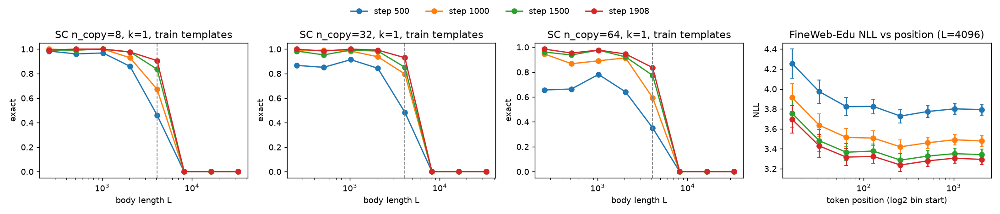
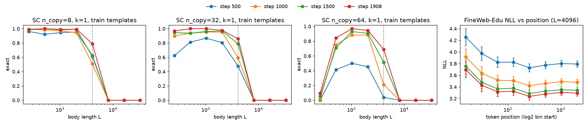
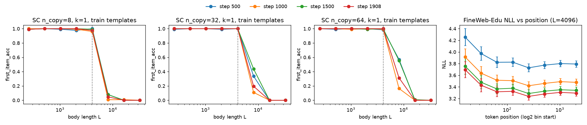
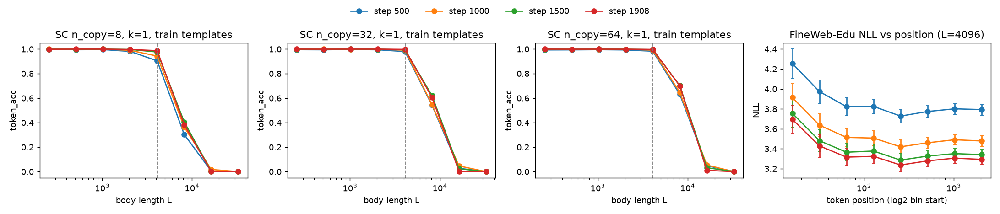
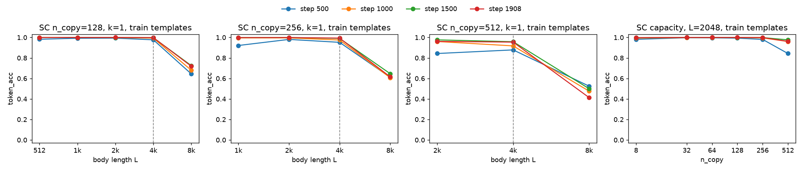
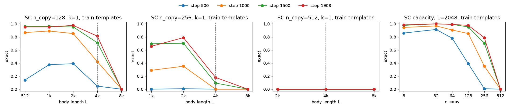
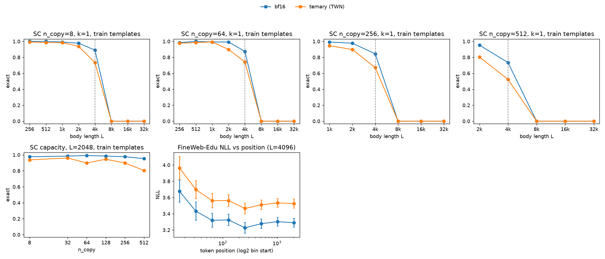
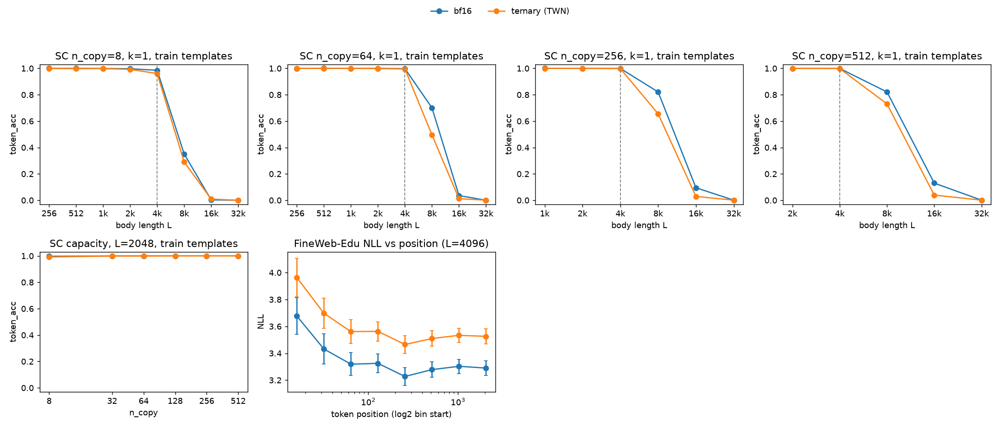
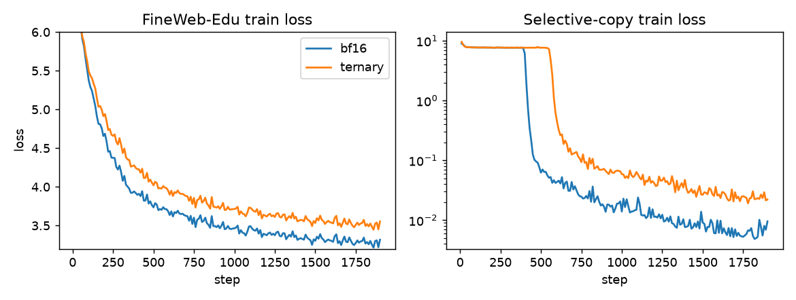
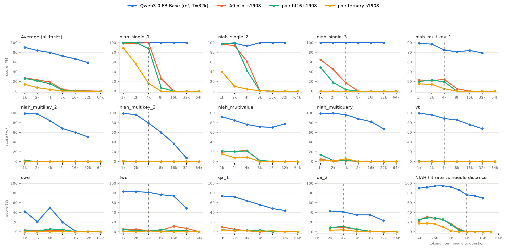

# Initial baseline: A0 pilot (Qwen3-S, full attention, T=4096, 1B tokens)

First result of the long-context ablation (design and full log: `~/diary/2026-10-18-long-context-synthetic-design.md`).
Selective-copy (SC) numbers here use **training templates only**: fresh instances rendered with the prompt templates
seen in training. That is the primary metric; held-out templates only measure prompt transfer.

**Takeaways**
- SC is learned abruptly: train SC loss stays at ln(2048) ≈ 7.6 (guessing among the content words) until step
  ~310, then falls to 0.9 by step 360. By step 500 SC is solved up to L=2k.
- Within the training length SC keeps improving with training: exact match at L=4k goes 0.35–0.48 (step 500) →
  0.84–0.93 (step 1908), and is ≥0.95 for L ≤ 2k at the end.
- **No length generalization.** Exact match is 0 at L=8k for every checkpoint, first-item accuracy ≤0.57 at 8k and
  ≈0 from 16k. It does not improve with training.
- FineWeb-Edu NLL (positions < T) falls with position and with training: mean 3.80 → 3.30.
- **n_copy generalizes; length does not.** Trained with n ≤ 64, the model still copies 128–256 words almost
  perfectly within T (exact 0.95–0.98 at n=128, token acc ≥ 0.99 at n=256), and 512 words at 0.96 per word. Unlike
  length, this improves with training. See [n_copy generalization](#n_copy-generalization).
- **Ternary weights cost loss, not copying.** At 1B tokens on the n ≤ 512 data, ternary (TWN) QAT ends 0.23 nats
  above bf16 on FineWeb NLL (3.53 vs 3.30), yet still copies up to 512 words within T at token accuracy ≈ 1.0. Only
  exact match drops (0.80 vs 0.95 at n=512). See [Ternary vs bf16](#ternary-vs-bf16-cap512-data-1b-tokens).
- **RULER: only single-needle retrieval, and only within T.** On the standard RULER suite the Qwen3-S models reach
  ≈100% on single-needle NIAH up to 2k, but ≈0 on every task with distractors or multiple steps. Past T they fail
  even when the needle is close to the question (0% at 16k for needles < 3k tokens back): positions > T break the
  model, not long lookback. Ternary loses most retrieval even within T (single-needle at 4k: 16% vs 88%), although
  its NLL is only 0.23 nats worse. See [RULER](#ruler).

## Model
| | |
|---|---|
| Architecture | Qwen3 decoder (`Qwen3ForCausalLM`), all 12 layers full causal attention (no sliding window) |
| Size | hidden 768, 12 layers, 12 query / 4 KV heads (GQA), head_dim 64, SwiGLU FFN 2048, RMSNorm (eps 1e-6) |
| Params | 308.9M total = 75.5M non-embedding + 233.4M embedding and untied lm_head (vocab 151,936) |
| Position encoding | RoPE, θ = 1e6; `max_position_embeddings` 131072 (so evaluation past T runs) |
| Tokenizer | Qwen3 (`~/models/Qwen3-0.6B-Base`) |
| Config | `configs/model_configs/qwen/Qwen3-S-longctx.json`; trained from scratch |

## Training setup
| | |
|---|---|
| Code | worktree `~/VeOmni-longctx`, branch `longctx-synth`, commit `3ea48b45` |
| Launch | `~/runs/longctx/a0_pilot_1B/launch.sh` → `tasks/train_text.py configs/text/longctx/qwen3_s_T4096.yaml --data.train_size 1000000000` (resolved config: `~/runs/longctx/a0_pilot_1B/veomni_cli.yaml`) |
| Hardware | 8× H200, FSDP2 (dp_shard 8), bf16 params / fp32 reduce, flash-attention 2, full activation checkpointing |
| Context | T = 4096 (`max_seq_len`); documents are chunked at T, so no position ≥ T is ever trained |
| Batch | 128 × 4096 tokens = 524,288 tokens/step (packed, dynamic batching), micro-batch 4 |
| Duration | 1,908 steps ≈ 1.0B tokens, 36 min (~1.12 s/step) |
| Optimizer | Muon for hidden matrices (lr 0.02, momentum 0.95 Nesterov, 5-step quintic Newton–Schulz schedule, spectral √(d_out/d_in) scaling, wd 0); AdamW for embeddings/lm_head/norms (lr 3e-3, β 0.9/0.95, wd 0.1); grad clip 1.0 |
| LR schedule | 1% linear warmup, cosine decay to 0.1× |
| Init | muP (embedding N(0,1), hidden spectral 1/√fan_in·min(1,√(fan_out/fan_in)), lm_head N(0,(1/fan_in)²)) |
| Seed | 42 |

### Training data (90/10 by tokens, `configs/text/longctx/mix_fineweb_sc10.yaml` at `3ea48b45`)
- **FineWeb-Edu** sample-10BT train split (`~/datasets/fineweb-edu-longctx/train`, 9.57M docs). Held out:
  md5(id) % 100 < 1 for docs < 16k GPT-2 tokens, < 25 for longer docs.
- **Selective copy**, 10% of tokens (`~/datasets/synthetic/selective_copy/train_T4096`, 4M recipes, about 1.2k
  tokens per sample). Each sample is prompt + body + question + answer. The body is L single-token items: filler
  `" ."` plus n content words drawn from a 2,048-word lexicon. The answer is the n words in order, followed by eos,
  and the loss is on the answer only. n ~ U{1..64}, L log-uniform in [max(64, 4n), T − overhead], words uniformly
  placed, prompt from 8 hand-written `nl` templates (`veomni/data/synthetic/harness.py`).
- In practice SC is 8.5–11.7% of tokens per step but only ~0.35% of loss tokens.
- Caveat: this run used the pre-fix lexicon (`30eac6a39fdd`). The eval lexicon (`12bacc2c1a25`) swaps 5 of the
  2,048 words (contraction stems for 5 other words), which is negligible.

## Evaluation setup
Script: `scripts/longctx/eval_longctx.py` (one teacher-forced forward per sequence, bf16, single sequences with no
packing, sdpa attention), run by `~/runs/longctx/a0_pilot_1B/eval_all.sh`. Outputs:
`~/runs/longctx/a0_pilot_1B/eval/step{500,1000,1500,1908}/results.json`.

**Selective-copy test set** `~/datasets/synthetic/selective_copy/test_nl` (`template_split == train` rows):
- Grid: L ∈ {256, 512, 1k, 2k, 4k, 8k, 16k, 32k} × n ∈ {8, 32, 64} × placement {`uniform` (anywhere in the
  body), `early` (first 25% of the body, i.e. maximum distance)}, 128 instances per cell, filler `" ."`, the same
  8 `nl` train templates.
- Instances are new: seeds ≥ 1e9 (training uses 0..4M), with positions and content pinned in the parquet file.
- At L=4k the full sequence is already slightly longer than T (prompt + question + answer ≈ 30 + n tokens).

Metrics:
- **exact**: all n words correct.
- **first-item acc**: the first answer word. This is pure retrieval; later words get help from teacher forcing,
  because the previous correct word is in the input.
- **token acc**: mean over the n answer words.

**Positional NLL**: held-out FineWeb-Edu docs, 256 docs truncated to exactly 4096 Qwen3 tokens
(`~/datasets/fineweb-edu-longctx/nll_eval_qwen3/L4096.parquet`), mean NLL in log2 position bins.

## Results

#### Exact match (all n items + order correct), placement `uniform`

| step | n_copy | 256 | 512 | 1k | 2k | 4k | 8k | 16k | 32k |
|---|---|---|---|---|---|---|---|---|---|
| 500 | 8 | 0.98 | 0.96 | 0.97 | 0.86 | 0.46 | 0.00 | 0.00 | 0.00 |
| 500 | 32 | 0.87 | 0.85 | 0.91 | 0.84 | 0.48 | 0.00 | 0.00 | 0.00 |
| 500 | 64 | 0.66 | 0.66 | 0.78 | 0.64 | 0.35 | 0.00 | 0.00 | 0.00 |
| 1000 | 8 | 1.00 | 0.99 | 1.00 | 0.93 | 0.67 | 0.00 | 0.00 | 0.00 |
| 1000 | 32 | 0.98 | 0.99 | 0.98 | 0.94 | 0.80 | 0.00 | 0.00 | 0.00 |
| 1000 | 64 | 0.95 | 0.87 | 0.89 | 0.91 | 0.59 | 0.00 | 0.00 | 0.00 |
| 1500 | 8 | 0.99 | 0.99 | 1.00 | 0.98 | 0.84 | 0.00 | 0.00 | 0.00 |
| 1500 | 32 | 0.98 | 0.95 | 0.99 | 0.98 | 0.85 | 0.00 | 0.00 | 0.00 |
| 1500 | 64 | 0.96 | 0.94 | 0.98 | 0.92 | 0.77 | 0.00 | 0.00 | 0.00 |
| 1908 | 8 | 0.99 | 1.00 | 1.00 | 0.98 | 0.91 | 0.00 | 0.00 | 0.00 |
| 1908 | 32 | 1.00 | 0.98 | 1.00 | 0.99 | 0.93 | 0.00 | 0.00 | 0.00 |
| 1908 | 64 | 0.98 | 0.95 | 0.98 | 0.95 | 0.84 | 0.00 | 0.00 | 0.00 |

#### Exact match (all n items + order correct), placement `early`

| step | n_copy | 256 | 512 | 1k | 2k | 4k | 8k | 16k | 32k |
|---|---|---|---|---|---|---|---|---|---|
| 500 | 8 | 0.96 | 0.92 | 0.95 | 0.95 | 0.62 | 0.00 | 0.00 | 0.00 |
| 500 | 32 | 0.62 | 0.81 | 0.87 | 0.80 | 0.48 | 0.00 | 0.00 | 0.00 |
| 500 | 64 | 0.00 | 0.41 | 0.50 | 0.45 | 0.04 | 0.00 | 0.00 | 0.00 |
| 1000 | 8 | 0.99 | 0.98 | 0.97 | 0.95 | 0.51 | 0.00 | 0.00 | 0.00 |
| 1000 | 32 | 0.90 | 0.94 | 0.95 | 0.95 | 0.59 | 0.00 | 0.00 | 0.00 |
| 1000 | 64 | 0.02 | 0.75 | 0.88 | 0.88 | 0.21 | 0.00 | 0.00 | 0.00 |
| 1500 | 8 | 0.98 | 1.00 | 0.99 | 0.99 | 0.61 | 0.00 | 0.00 | 0.00 |
| 1500 | 32 | 0.95 | 0.94 | 0.96 | 0.97 | 0.79 | 0.00 | 0.00 | 0.00 |
| 1500 | 64 | 0.05 | 0.71 | 0.93 | 0.91 | 0.52 | 0.00 | 0.00 | 0.00 |
| 1908 | 8 | 0.99 | 1.00 | 0.98 | 0.99 | 0.79 | 0.00 | 0.00 | 0.00 |
| 1908 | 32 | 0.97 | 1.00 | 1.00 | 0.98 | 0.86 | 0.00 | 0.00 | 0.00 |
| 1908 | 64 | 0.09 | 0.84 | 0.97 | 0.95 | 0.69 | 0.00 | 0.00 | 0.00 |

The `early`, L=256, n=64 cell is degenerate: all 64 words fill the first 64 body slots back to back, which never
happens in training (n ≤ L/4).

#### First-item accuracy (pure retrieval, no teacher-forced induction help), placement `uniform`

| step | n_copy | 256 | 512 | 1k | 2k | 4k | 8k | 16k | 32k |
|---|---|---|---|---|---|---|---|---|---|
| 500 | 8 | 0.99 | 1.00 | 0.99 | 0.98 | 1.00 | 0.08 | 0.00 | 0.00 |
| 500 | 32 | 0.99 | 1.00 | 1.00 | 0.99 | 1.00 | 0.34 | 0.00 | 0.00 |
| 500 | 64 | 1.00 | 0.99 | 1.00 | 1.00 | 0.98 | 0.57 | 0.00 | 0.00 |
| 1000 | 8 | 1.00 | 1.00 | 1.00 | 0.99 | 0.96 | 0.01 | 0.01 | 0.00 |
| 1000 | 32 | 1.00 | 1.00 | 1.00 | 1.00 | 1.00 | 0.11 | 0.00 | 0.00 |
| 1000 | 64 | 1.00 | 1.00 | 0.99 | 1.00 | 0.99 | 0.16 | 0.00 | 0.00 |
| 1500 | 8 | 0.99 | 1.00 | 1.00 | 1.00 | 0.99 | 0.08 | 0.00 | 0.00 |
| 1500 | 32 | 1.00 | 1.00 | 1.00 | 1.00 | 1.00 | 0.44 | 0.00 | 0.00 |
| 1500 | 64 | 1.00 | 1.00 | 1.00 | 0.99 | 1.00 | 0.55 | 0.01 | 0.00 |
| 1908 | 8 | 0.99 | 1.00 | 1.00 | 1.00 | 0.98 | 0.05 | 0.00 | 0.00 |
| 1908 | 32 | 1.00 | 1.00 | 1.00 | 1.00 | 1.00 | 0.20 | 0.00 | 0.00 |
| 1908 | 64 | 1.00 | 1.00 | 1.00 | 1.00 | 1.00 | 0.31 | 0.00 | 0.00 |

#### Token accuracy (teacher-forced, per answer item), placement `uniform`

| step | n_copy | 256 | 512 | 1k | 2k | 4k | 8k | 16k | 32k |
|---|---|---|---|---|---|---|---|---|---|
| 500 | 8 | 1.00 | 1.00 | 1.00 | 0.98 | 0.90 | 0.30 | 0.00 | 0.00 |
| 500 | 32 | 1.00 | 0.99 | 1.00 | 0.99 | 0.98 | 0.54 | 0.03 | 0.00 |
| 500 | 64 | 0.99 | 0.99 | 1.00 | 0.99 | 0.98 | 0.63 | 0.05 | 0.00 |
| 1000 | 8 | 1.00 | 1.00 | 1.00 | 0.99 | 0.94 | 0.36 | 0.02 | 0.00 |
| 1000 | 32 | 1.00 | 1.00 | 1.00 | 1.00 | 0.99 | 0.55 | 0.05 | 0.00 |
| 1000 | 64 | 1.00 | 1.00 | 1.00 | 1.00 | 0.99 | 0.65 | 0.05 | 0.00 |
| 1500 | 8 | 1.00 | 1.00 | 1.00 | 1.00 | 0.98 | 0.41 | 0.00 | 0.00 |
| 1500 | 32 | 1.00 | 1.00 | 1.00 | 1.00 | 0.99 | 0.62 | 0.02 | 0.00 |
| 1500 | 64 | 1.00 | 1.00 | 1.00 | 1.00 | 1.00 | 0.70 | 0.03 | 0.00 |
| 1908 | 8 | 1.00 | 1.00 | 1.00 | 1.00 | 0.99 | 0.38 | 0.00 | 0.00 |
| 1908 | 32 | 1.00 | 1.00 | 1.00 | 1.00 | 1.00 | 0.61 | 0.00 | 0.00 |
| 1908 | 64 | 1.00 | 1.00 | 1.00 | 1.00 | 1.00 | 0.70 | 0.01 | 0.00 |

#### FineWeb-Edu held-out NLL by position (L=4096 eval set, 256 docs, positions < T)

| step | mean NLL | [16,32) | [32,64) | [64,128) | [128,256) | [256,512) | [512,1024) | [1024,2048) | [2048,4096) |
|---|---|---|---|---|---|---|---|---|---|
| 500 | 3.796 | 4.25 | 3.97 | 3.82 | 3.83 | 3.73 | 3.77 | 3.80 | 3.79 |
| 1000 | 3.483 | 3.91 | 3.64 | 3.51 | 3.51 | 3.42 | 3.46 | 3.49 | 3.48 |
| 1500 | 3.346 | 3.76 | 3.48 | 3.37 | 3.38 | 3.29 | 3.33 | 3.35 | 3.34 |
| 1908 | 3.298 | 3.69 | 3.43 | 3.32 | 3.32 | 3.24 | 3.28 | 3.31 | 3.29 |

### Plots
Training templates, k=1 filler. The dashed line marks T=4096, and the right panel is FineWeb-Edu NLL vs position
(< T).

Exact match, `uniform` placement:


Exact match, `early` placement:


First-item accuracy, `uniform`:


Token accuracy, `uniform`:


Regenerate:
```bash
E=~/runs/longctx/a0_pilot_1B/eval
python scripts/longctx/plot_longctx.py --results $E/step{500,1000,1500,1908}/results.json \
  --labels "step 500" "step 1000" "step 1500" "step 1908" --train_len 4096 \
  --template_split train --metric exact --placement uniform --out initial_baseline_plots/sc_exact_uniform.png
```

## n_copy generalization
Training only saw n ≤ 64. This asks how many words the same checkpoints can copy beyond that.

**Test set** `~/datasets/synthetic/selective_copy/test_cap_nl_diag` (commit `56d17541`): the same 8 `nl` train
templates, `uniform` placement, L ∈ {256 … 8k} × n ∈ {8, 32, 64, 128, 256, 512}, 128 instances per cell. Cells with
L < 4n are skipped (training keeps n ≤ L/4). Content words are drawn **without replacement**: with replacement,
512 draws from 2,048 words repeat ~64 pairs, and a repeated word makes "the word after X" ambiguous. Seeds and
content therefore differ from `test_nl`, so n ≤ 64 numbers here match the tables above only statistically. Outputs:
`~/runs/longctx/a0_pilot_1B/eval/step{500,1000,1500,1908}_cap_nl/{results.json,sc_samples.jsonl}`.

#### Token accuracy, placement `uniform` (– = cell skipped, L < 4n)

| step | n_copy | 256 | 512 | 1k | 2k | 4k | 8k |
|---|---|---|---|---|---|---|---|
| 500 | 64 | 1.00 | 1.00 | 1.00 | 1.00 | 0.99 | 0.63 |
| 500 | 128 | – | 0.98 | 0.99 | 0.99 | 0.98 | 0.64 |
| 500 | 256 | – | – | 0.92 | 0.98 | 0.95 | 0.61 |
| 500 | 512 | – | – | – | 0.84 | 0.88 | 0.52 |
| 1000 | 64 | 1.00 | 1.00 | 1.00 | 1.00 | 1.00 | 0.64 |
| 1000 | 128 | – | 1.00 | 1.00 | 1.00 | 0.99 | 0.68 |
| 1000 | 256 | – | – | 1.00 | 1.00 | 0.97 | 0.61 |
| 1000 | 512 | – | – | – | 0.96 | 0.92 | 0.48 |
| 1500 | 64 | 1.00 | 1.00 | 1.00 | 1.00 | 1.00 | 0.70 |
| 1500 | 128 | – | 1.00 | 1.00 | 1.00 | 1.00 | 0.73 |
| 1500 | 256 | – | – | 1.00 | 1.00 | 0.99 | 0.65 |
| 1500 | 512 | – | – | – | 0.98 | 0.96 | 0.50 |
| 1908 | 64 | 1.00 | 1.00 | 1.00 | 1.00 | 1.00 | 0.70 |
| 1908 | 128 | – | 1.00 | 1.00 | 1.00 | 1.00 | 0.72 |
| 1908 | 256 | – | – | 1.00 | 1.00 | 0.99 | 0.62 |
| 1908 | 512 | – | – | – | 0.96 | 0.95 | 0.41 |

#### Exact match, placement `uniform`

| step | n_copy | 256 | 512 | 1k | 2k | 4k | 8k |
|---|---|---|---|---|---|---|---|
| 500 | 64 | 0.74 | 0.81 | 0.86 | 0.78 | 0.39 | 0.00 |
| 500 | 128 | – | 0.14 | 0.38 | 0.39 | 0.05 | 0.00 |
| 500 | 256 | – | – | 0.00 | 0.01 | 0.00 | 0.00 |
| 500 | 512 | – | – | – | 0.00 | 0.00 | 0.00 |
| 1000 | 64 | 0.94 | 0.97 | 0.95 | 0.91 | 0.74 | 0.00 |
| 1000 | 128 | – | 0.87 | 0.89 | 0.85 | 0.42 | 0.00 |
| 1000 | 256 | – | – | 0.29 | 0.35 | 0.00 | 0.00 |
| 1000 | 512 | – | – | – | 0.00 | 0.00 | 0.00 |
| 1500 | 64 | 0.96 | 0.98 | 0.98 | 0.99 | 0.91 | 0.00 |
| 1500 | 128 | – | 0.96 | 0.96 | 0.95 | 0.71 | 0.00 |
| 1500 | 256 | – | – | 0.70 | 0.70 | 0.09 | 0.00 |
| 1500 | 512 | – | – | – | 0.00 | 0.00 | 0.00 |
| 1908 | 64 | 0.98 | 0.98 | 0.98 | 0.99 | 0.91 | 0.00 |
| 1908 | 128 | – | 0.95 | 0.95 | 0.98 | 0.81 | 0.00 |
| 1908 | 256 | – | – | 0.66 | 0.79 | 0.18 | 0.00 |
| 1908 | 512 | – | – | – | 0.00 | 0.00 | 0.00 |

n = 8 and 32 (omitted) behave like the earlier tables. At step 1908 their exact match is 0.98–1.00 for L ≤ 2k.

#### Where the errors are (from `sc_samples.jsonl`)
Token accuracy by answer index, plus mean wrong words per sequence, and accuracy on the word right after a wrong one:

| step | cell | items 0–63 | 64–127 | 128–255 | 256–511 | wrong words | acc after a wrong word |
|---|---|---|---|---|---|---|---|
| 500 | L2k n512 | 0.94 | 0.89 | 0.86 | 0.80 | 80 | 0.75 |
| 1500 | L2k n512 | 1.00 | 0.99 | 0.98 | 0.97 | 12 | 0.92 |
| 1908 | L2k n256 | 1.00 | 1.00 | 1.00 | – | 0.2 | 1.00 |
| 1908 | L2k n512 | 1.00 | 0.99 | 0.98 | 0.94 | 20 | 0.89 |
| 1908 | L4k n512 | 0.95 | 0.93 | 0.93 | 0.97 | 23 | 0.88 |

**Findings**
- **Full attention extrapolates in n.** Within T, a model trained on n ≤ 64 copies 128 words as well as 64
  (exact 0.95–0.98 at L ≤ 2k), and 256 at token accuracy ≥ 0.99. At n=512 it still gets ~0.96 of the words.
  This matches the mechanism: under teacher forcing each answer word is a separate lookup ("find the previous
  answer word in the body, copy the next content word"), which does not need memory that grows with n.
- **Unlike length, it improves with training.** At L=2k, n=512, token accuracy rises from 0.84 (step 500) to
  0.96–0.98, and exact match at n=256 rises from 0.01 to 0.79. Length generalization stays at 0 at every step.
- **The degradation is gradual, not a cliff.** At L=2k, n=512, accuracy falls smoothly with answer index (1.00 at
  items < 64 → 0.94 at items 256–511). Errors are scattered (~20 per 512-word answer) and do not cascade: the word
  after a mistake is still right 89% of the time.
- **At L=4k, n and distance interact.** At L=4k, n=512, the early and middle answer words are worse (0.93–0.95) than
  the last ones (0.97). By distance from the source word to the end of the body, accuracy falls from 0.98 (< 1k)
  to 0.93–0.95 (2k–4k). At n=64 the same distances show no effect (≥ 0.997), so long distances only hurt when there
  are many words. Also, an L=4k, n=512 sequence is ~4.65k tokens, so the later answer words sit at positions past
  T. For a clean capacity read, use L ≤ 2k.
- **Exact match is the wrong capacity metric at large n.** 0.96 per word gives exact ≈ 0 over 512 words. For the
  capacity axis, report token accuracy (or words recalled = n · token acc); keep exact match for n ≤ 64.
- **What this sets up:** attention has no fixed-size memory, so a flat curve in n is expected here. The comparison
  that matters is a recurrent or hybrid arm with a fixed-size state, trained on the same `train_T4096_cap512` data
  (n log-uniform in 1..512).

Token accuracy, n ∈ {128, 256, 512} vs L, plus capacity at L=2k (right):


Exact match, same layout:


Regenerate:
```bash
D=~/datasets/synthetic/selective_copy R=~/runs/longctx/a0_pilot_1B
python scripts/longctx/make_recipes.py test --fmt nl --template_splits train --ctx_lens 256 512 1024 2048 4096 8192 \
  --placements uniform --tokenizer ~/models/Qwen3-0.6B-Base --out_dir $D/test_cap_nl_diag
for s in 500 1000 1500 1908; do
  torchrun --nproc_per_node 8 scripts/longctx/eval_longctx.py --model_path $R/checkpoints/global_step_$s/hf_ckpt \
    --sc_test_dir $D/test_cap_nl_diag --out_dir $R/eval/step${s}_cap_nl
done
python scripts/longctx/plot_longctx.py --results $R/eval/step{500,1000,1500,1908}_cap_nl/results.json \
  --labels "step 500" "step 1000" "step 1500" "step 1908" --train_len 4096 --metric token_acc \
  --n_copies 128 256 512 --capacity_len 2048 --out initial_baseline_plots/sc_ncopy_token_acc.png
```

## Ternary vs bf16 (cap512 data, 1B tokens)
Two new runs, identical except for `model.qat.weight`: bf16, and ternary weights via TWN quantization-aware training.

**What ternary means here** (`veomni/ops/qat/ternary.py`, commit `6bd6eeaf`): each row of every hidden
`nn.Linear` (q/k/v/o, gate/up/down; 84 matrices, 75.5M parameters) is used in the forward as α·{−1, 0, +1}. Entries
with |w| ≤ 0.7·mean|w| of the row become 0 (~42% of them), and α is the mean |w| of the rest. Gradients reach the latent
full-precision weights unchanged (straight-through estimator). Embeddings, lm_head and norms stay bf16, and
activations are not quantized. Checkpoints hold the latent weights, so evals ternarize at load (`--qat_weight
ternary_twn`).

Ternarizing the bf16 pilot *after* training (no QAT) destroys it: NLL 3.30 → 6.12 and SC accuracy → 0, whether the
scale is per row or per 128-weight group. Ternary weights have to be trained.

**Setup** (differs from the pilot above in data only):
- Training data: `mix_fineweb_sc10.yaml` → `train_T4096_cap512`. Same mix (90/10), but SC uses n_copy log-uniform in
  1..512 (no repeated words) and the composed `nl2` templates.
- Same model, optimizer and schedule as the pilot: 1,908 steps ≈ 1B tokens, Muon lr 0.02. A 200-step sweep put the
  ternary optimum at Muon lr 0.02–0.04 (0.01: 5.21, 0.02: 4.99, 0.04: 5.01, 0.08: 5.15 FineWeb loss; bf16 4.81).
- Run dir `~/runs/longctx/qat_pair_1B/` (`run.sh`; tables `pair_tables.md` from `pair_tables.py`). Each run took
  ~41 min on 8× H200; fake quantization adds ~10% per step.
- Eval: `test_cap` (`nl2` templates; L ∈ {256 … 32k} × n ∈ {8 … 512}, cells with L < 4n skipped; 128 instances per
  cell) and the same FineWeb positional NLL sets. SC numbers below use **train templates, uniform placement**.

#### FineWeb-Edu held-out NLL (bf16 / ternary)

| step | mean NLL, L=4k set | [2k,4k) | [4k,8k) | [8k,16k) | [16k,32k) |
|---|---|---|---|---|---|
| 500 | 3.79 / 4.08 | 3.84 / 4.14 | 3.88 / 4.17 | 4.01 / 4.28 | 4.23 / 4.44 |
| 1000 | 3.48 / 3.73 | 3.53 / 3.78 | 3.59 / 3.82 | 3.75 / 3.95 | 4.08 / 4.19 |
| 1500 | 3.34 / 3.58 | 3.39 / 3.63 | 3.46 / 3.69 | 3.65 / 3.84 | 4.06 / 4.14 |
| 1908 | **3.30 / 3.53** | 3.34 / 3.58 | 3.42 / 3.63 | 3.63 / 3.78 | 4.08 / 4.09 |

Bins past 4k come from the L=32k set (same docs in every bin).

#### Selective copy, step 1908: exact match (bf16 / ternary)

| n_copy | 256 | 512 | 1k | 2k | 4k | 8k |
|---|---|---|---|---|---|---|
| 8 | 1.00 / 0.99 | 1.00 / 0.98 | 0.99 / 0.98 | 0.98 / 0.94 | 0.89 / 0.73 | 0.00 / 0.00 |
| 32 | 1.00 / 0.98 | 1.00 / 0.98 | 0.98 / 0.98 | 0.98 / 0.96 | 0.91 / 0.66 | 0.00 / 0.00 |
| 64 | 0.98 / 0.98 | 1.00 / 0.98 | 0.99 / 0.99 | 0.99 / 0.90 | 0.88 / 0.74 | 0.00 / 0.00 |
| 128 | – | 0.98 / 0.98 | 0.98 / 0.96 | 0.98 / 0.95 | 0.89 / 0.60 | 0.00 / 0.00 |
| 256 | – | – | 0.99 / 0.95 | 0.98 / 0.90 | 0.84 / 0.67 | 0.00 / 0.00 |
| 512 | – | – | – | 0.95 / 0.80 | 0.73 / 0.52 | 0.00 / 0.00 |

#### Selective copy, step 1908: token accuracy (bf16 / ternary)

| n_copy | 256 | 512 | 1k | 2k | 4k | 8k | 16k |
|---|---|---|---|---|---|---|---|
| 8 | 1.00 / 1.00 | 1.00 / 1.00 | 1.00 / 1.00 | 1.00 / 0.99 | 0.99 / 0.96 | 0.35 / 0.29 | 0.00 / 0.01 |
| 64 | 1.00 / 1.00 | 1.00 / 1.00 | 1.00 / 1.00 | 1.00 / 1.00 | 1.00 / 1.00 | 0.70 / 0.50 | 0.04 / 0.01 |
| 256 | – | – | 1.00 / 1.00 | 1.00 / 1.00 | 1.00 / 1.00 | 0.82 / 0.66 | 0.09 / 0.03 |
| 512 | – | – | – | 1.00 / 1.00 | 1.00 / 1.00 | 0.82 / 0.73 | 0.13 / 0.04 |

#### Capacity over training: exact match at L=2k (bf16 / ternary)

| step | n=8 | 32 | 64 | 128 | 256 | 512 |
|---|---|---|---|---|---|---|
| 500 | 0.88 / 0.00 | 0.76 / 0.00 | 0.79 / 0.00 | 0.72 / 0.00 | 0.66 / 0.00 | 0.36 / 0.00 |
| 1000 | 0.96 / 0.91 | 0.95 / 0.90 | 0.94 / 0.79 | 0.98 / 0.84 | 0.97 / 0.80 | 0.84 / 0.43 |
| 1500 | 0.97 / 0.92 | 0.98 / 0.92 | 0.98 / 0.90 | 0.98 / 0.93 | 0.97 / 0.87 | 0.93 / 0.77 |
| 1908 | 0.98 / 0.94 | 0.98 / 0.96 | 0.99 / 0.90 | 0.98 / 0.95 | 0.98 / 0.90 | 0.95 / 0.80 |

**Findings**
- **NLL: ternary is 0.23 nats worse at 1B tokens, and the gap closes slowly** (0.29 → 0.25 → 0.24 → 0.23 at steps
  500 → 1908). Ternary at step 1908 (3.53) matches bf16 at ~step 900 (interpolating 3.79 at 500 and 3.48 at
  1000), so it needs roughly 2× the tokens for the same NLL at this size (75.5M non-embedding parameters).
- **Copying survives ternary weights.** Within T, token accuracy is ≈ 1.0 for every n up to 512, the same as
  bf16. Ternary loses per-item reliability, which exact match amplifies: 0.80 vs 0.95 at n=512, L=2k, and
  0.52–0.74 vs 0.73–0.91 at L=4k. This fits the copy mechanism living in attention over activations (the KV cache),
  which ternary weights don't touch.
- **Ternary learns the task later.** Train SC loss collapses at step ~600 vs ~430 for bf16, and its final SC loss
  is 0.022 vs 0.009. Its step-500 checkpoint is still pre-transition (exact 0 everywhere).
- **Neither generalizes in length.** Exact match is 0 at L=8k for both, and ternary's token accuracy past T is
  lower. Ternary's NLL rises less past T (+0.51 from [2k,4k) to [16k,32k), vs +0.74 for bf16), but only because its
  in-T NLL is worse: both end at ≈ 4.08 in [16k,32k).
- **Held-out templates** (not tabled; `pair_tables.md`): ternary's exact match is *higher* than bf16 at L ≤ 2k
  (e.g. n=32, L=256: 0.91 vs 0.70; n=512, L=2k: 0.70 vs 0.50). bf16 seems to fit the training templates more
  tightly. Not yet diagnosed; a first-item check would show whether this is the prompt-shortcut effect from the
  pilot.
- **The cap512 data costs nothing on FineWeb.** bf16 here reaches NLL 3.295 at step 1908 vs 3.298 for the pilot,
  and n=512 is now learned (exact 0.95 at L=2k, vs 0.00 for the pilot trained on n ≤ 64).

Exact match, step 1908 (per-n panels vs L, capacity at L=2k, NLL vs position < T):


Token accuracy, same layout:


Training loss (FineWeb channel and selective-copy channel):


Reproduce:
```bash
# training: --model.qat.weight ternary_twn (or none), everything else as the pilot
torchrun --nproc_per_node 8 tasks/train_text.py configs/text/longctx/qwen3_s_T4096.yaml \
  --model.qat.weight ternary_twn --data.train_size 1000000000 --train.checkpoint.save_steps 500 \
  --train.checkpoint.output_dir ~/runs/longctx/qat_pair_1B/ternary
# eval a ternary checkpoint (ternarizes the latent weights at load)
torchrun --nproc_per_node 8 scripts/longctx/eval_longctx.py --model_path <step>/hf_ckpt --qat_weight ternary_twn \
  --sc_test_dir ~/datasets/synthetic/selective_copy/test_cap --nll_dir ~/datasets/fineweb-edu-longctx/nll_eval_qwen3 \
  --out_dir <run>/eval/step<N>
python scripts/longctx/plot_longctx.py --results <bf16>/eval/step1908/results.json <ternary>/eval/step1908/results.json \
  --labels bf16 "ternary (TWN)" --train_len 4096 --metric exact --n_copies 8 64 256 512 --capacity_len 2048 \
  --out initial_baseline_plots/ternary_vs_bf16_exact.png
```

## RULER
The standard external long-context benchmark (Hsieh et al. 2024, NVIDIA/RULER), ported as `veomni.eval.ruler`
(commit `effb9e31`): 13 tasks, i.e. 8 needle-in-a-haystack (NIAH) variants (retrieval), variable tracking (VT,
multi-hop), common / frequent words extraction (CWE / FWE, aggregation), and SQuAD / HotpotQA multi-document QA.
Unlike selective copy, the model has to find a fact *by key* in prose or among distractors, from an
instruction-style prompt it never saw in training.

**Setup**
- Upstream templates, haystacks (Paul Graham essays, filler sentence, distractor needles), `base` template (the model
  continues `input + answer_prefix`), greedy decoding, no stop words, upstream `string_match_all/part` scoring.
  Length = prompt + tokens to generate, each prompt filled to that length to within ~0.5% (QA by whole documents).
- 100 prompts per (task, length) (upstream: 500), L ∈ {1k, 2k, 4k, 8k, 16k, 32k, 64k}, Qwen3 tokenizer, seed 42:
  `~/datasets/ruler/qwen3`. HotpotQA does not fit in 1k (its 10 paragraphs); 9 of its 2k prompts were dropped.
- Differences from upstream generation (none changes what a prompt tests): one seeded RNG per sample; QA questions
  in a seeded order, where upstream's first 100 SQuAD questions all come from one article; distractor keys never
  equal the real key.
- Models: the three step-1908 checkpoints above, plus **Qwen3-0.6B-Base** (trained to 32k) as a reference, which
  also checks the pipeline. Runs: `~/runs/longctx/ruler/<model>/results.json` (+ `predictions.jsonl`).

#### Average over the 13 tasks (%)

| model | 1k | 2k | 4k | 8k | 16k | 32k | 64k |
|---|---|---|---|---|---|---|---|
| Qwen3-0.6B-Base (reference) | 90.4 | 83.9 | 79.9 | 72.4 | 66.8 | 58.9 | – |
| A0 pilot, step 1908 | 27.3 | 23.3 | 18.7 | 3.3 | 0.9 | 0.5 | 0.0 |
| cap512 bf16, step 1908 | 26.2 | 21.5 | 15.2 | 2.1 | 0.3 | 0.1 | 0.0 |
| cap512 ternary, step 1908 | 14.1 | 7.2 | 3.6 | 0.3 | 0.2 | 0.0 | 0.0 |
| cap512 bf16, step 500 | 2.5 | 1.5 | 0.9 | 0.9 | 0.6 | 0.3 | 0.1 |

#### NIAH tasks the Qwen3-S models score on (%, L = 1k / 2k / 4k / 8k; 0 from 16k on)

| model | single_1 (filler) | single_2 (essay) | single_3 (essay, uuid value) | multikey_1 | multivalue |
|---|---|---|---|---|---|
| Qwen3-0.6B-Base | 100/100/100/100 | 98/99/93/100 | 100/100/100/100 | 99/97/85/81 | 92/85/76/72 |
| A0 pilot | 99/99/100/26 | 97/94/61/1 | 65/45/17/0 | 23/22/24/5 | 19/21/22/1 |
| cap512 bf16 | 100/100/88/7 | 97/100/42/1 | 49/18/3/0 | 20/23/19/0 | 22/21/22/2 |
| cap512 ternary | 89/56/16/0 | 40/10/4/1 | 0/0/0/0 | 15/14/5/0 | 16/8/8/0 |

The other 8 tasks (multikey_2/3, multiquery, VT, CWE, FWE, QA ×2) are ≤ 14% for every Qwen3-S model at every length.

**Findings**
- **The reference behaves like published RULER numbers**: single NIAH ≈100 at all lengths; uuid keys among uuid
  distractors (multikey_3) fall hardest (99 → 7 at 32k); CWE is the hardest task and non-monotone at short L; QA
  (SQuAD / HotpotQA) 72 / 43 at 2k. So the generation, length fitting and scoring are sound.
- **Qwen3-S does single-needle retrieval and nothing harder.** Every distractor or multi-step task is at the
  floor at every length, a capability limit of a 310M model at 1B tokens, not a context effect. Failure modes from
  `predictions.jsonl`: multikey_2 answers with a distractor's value; VT copies the variable names of its in-context
  example; CWE / FWE loop on one word. At this scale RULER only separates models through NIAH single /
  multikey_1 / multivalue.
- **Past T the model breaks; it is not the lookback.** At L=16k, needles less than 3k tokens before the question
  score 0 (A0, niah_single_1: 0 of 19). At 8k such needles are still found 64% of the time (23 / 36); needles
  more than 4k back, never. From ~2T, outputs degenerate into filler loops ("The sky is blue. The sky is blue…"). It is the absolute
  positions > T (RoPE θ=1e6, never trained past 4k) that fail, as in the positional-NLL rise past T.
- **Within T, NIAH falls with needle distance**: A0 at L=4k hits 81% of needles < 64 tokens before the question
  but 11% of those 2–4k back, while selective copy at 4k is ≈100% at every distance. The copy skill trained by SC
  does not transfer to keyed retrieval in prose; the "magic number" needles are found mostly by recency.
- **NIAH emerges after SC.** At step 500, bf16 already copies (SC exact 0.88 at n=8, L=2k) but scores 2.5% on RULER
  at 1k (single_1: 9%).
- **Ternary loses retrieval even within T**: single_1 89 / 56 / 16 at 1k / 2k / 4k vs bf16 100 / 100 / 88, and
  single_3 (uuid values) 0 everywhere vs 49 at 1k. SC token accuracy is unchanged and NLL is only 0.23 nats worse, so
  keyed retrieval is the most sensitive of our metrics to ternary weights.
- A0 pilot ≥ cap512 bf16 on NIAH at 4k (single_1 100 vs 88, single_2 61 vs 42) despite bf16's richer SC data. One
  seed each, so not conclusive; RULER on steps 1000 / 1500 is queued (`~/runs/longctx/ruler/run_ruler.sh`).

Score vs length per task, the average, and NIAH hit rate vs needle distance (pooled over lengths); dotted line = T:


Reproduce:
```bash
# one-time: raw data (PG essays, SQuAD, HotpotQA) + prompts for the Qwen3 tokenizer (~15 min on 24 CPU workers)
python scripts/longctx/ruler/download_ruler_data.py --out_dir ~/datasets/ruler/raw
python scripts/longctx/ruler/prepare_ruler.py --tokenizer ~/models/Qwen3-0.6B-Base --raw_dir ~/datasets/ruler/raw \
  --out_dir ~/datasets/ruler/qwen3 --lengths 1024 2048 4096 8192 16384 32768 65536 --workers 24
# eval (~8-13 min per model on 8x H200; sdpa: FA2 + left-padded generate is broken under the VeOmni backend)
torchrun --nproc_per_node 8 scripts/longctx/ruler/eval_ruler.py --model_path <step>/hf_ckpt \
  --tokenizer_path ~/models/Qwen3-0.6B-Base --data_dir ~/datasets/ruler/qwen3 --out_dir <out> [--qat_weight ternary_twn]
python scripts/longctx/ruler/plot_ruler.py --results <a>/results.json <b>/results.json --labels A B --train_len 4096 \
  --out initial_baseline_plots/ruler_s1908.png
```

## Notes
- Held-out templates (not shown) give lower first-item accuracy that falls with training. Cause: every `nl` train
  prefix has exactly one colon, right before the body, and the model learned "the answer starts after the first
  colon". Fixed for future runs by the composed `nl2` templates (`6d5741f5`).
- The next baseline should be trained on `train_T4096_cap512` (nl2 templates, n log-uniform in 1..512, unique
  content; the current `mix_fineweb_sc10.yaml`) and evaluated on `test_cap` (train split primary).
